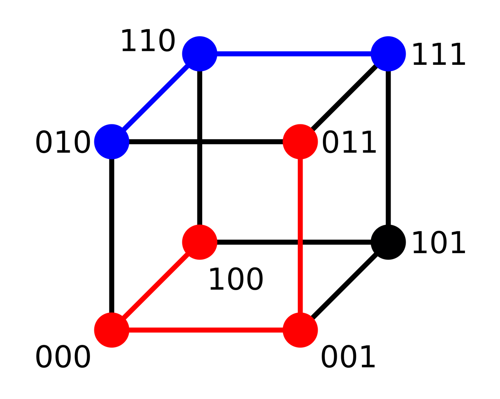
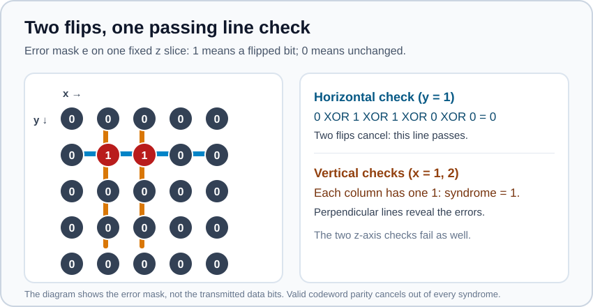
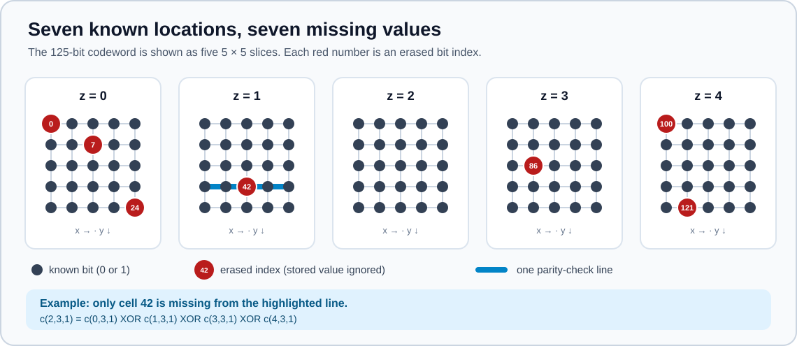
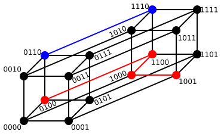

# HammingCube: a three-dimensional parity code in C

**A small, inspectable error-correcting system from sender to receiver.** The
sender turns 64 payload bits into a 125-bit cube. A channel may flip bits. The
receiver calculates parity-check failures (a *syndrome*) and finds the nearest
codeword within Hamming distance three. The implementation uses C11 and the
standard library only. A second decoder reconstructs known missing positions
(*erasures*) by solving parity equations over $\mathrm{GF}(2)$.

This repository is also a guided lesson: each formula below corresponds to a
specific operation in [`src/parity3d.c`](src/parity3d.c).

**Terminology:** *Hamming distance* is the number of differing bit positions.
The code built here is a **three-dimensional product of single-parity-check
codes**, not the classical binary Hamming code (such as $(7,4,3)$). Its
minimum Hamming distance is eight.

## Try it

```sh
make
./hammingcube encode 0123456789abcdef
./hammingcube decode cf7706b64a185c532818320200000000
./hammingcube demo 0123456789abcdef 7 42 100
./hammingcube erase 0123456789abcdef 7 42 100 121 0 24 86
./hammingcube recover 4e7706b64a185c532818320200000000 7 42 100 121 0 24 86
make test
```

`encode` emits exactly 32 hexadecimal digits representing a 16-byte frame;
`decode` accepts that frame in a separate process. For example:

```text
$ ./hammingcube encode 0123456789abcdef
cf7706b64a185c532818320200000000
$ ./hammingcube decode cf7706b64a185c532818320200000000
Receiver:          valid codeword (zero syndrome)
Recovered data:    0123456789abcdef
```

The `demo` command runs sender, simulated channel, and receiver together:

```text
Sender data:       0123456789abcdef
Encoded:           64 data bits + 61 parity bits = 125 bits
Wire frame:        cf7706b64a185c532818320200000000 (16 bytes)
Channel flips:     7, 42, 100
Receiver:          corrected 3 bit(s) at 7 42 100
Recovered data:    0123456789abcdef
Channel distance:  3 bit(s)
```

The `HEX64` argument is exactly 16 hexadecimal digits (64 bits). In `demo`,
each following argument is a **linear codeword bit index** from 0 to 124 to
flip in the simulated channel. Repeating an index flips that bit twice. The
program exits with status 0 after successful decoding, 1 if it finds no
codeword within distance three, and 2 for invalid input or frame padding.

`erase` is a sender/channel/receiver demonstration: it replaces the listed
bits with zero and tells the receiver **which positions were erased**. For
example, all seven positions below are recovered:

```text
$ ./hammingcube erase 0123456789abcdef 7 42 100 121 0 24 86
Sender data:       0123456789abcdef
Wire frame:        cf7706b64a185c532818320200000000
Received frame:    4e7706b64a185c532818320200000000
Erased positions:  7, 42, 100, 121, 0, 24, 86
Receiver:          recovered 7 erased bit(s)
Recovered data:    0123456789abcdef
```

`recover FRAMEHEX [ERASED_INDEX ...]` is the separate-process receiver form.
Its frame may contain **either 0 or 1** at an erased position: those values
are ignored. The caller must supply distinct indices from 0 to 124; the code
cannot discover erasure locations from the frame alone. Both erasure commands
return status 1 when parity equations have no solution or multiple solutions,
and status 2 for invalid input. The derivation follows in section 4.

## 1. From one parity bit to a 3D code

For four data bits, a single even-parity code appends their XOR:

$$p=a_0\oplus a_1\oplus a_2\oplus a_3.$$

Its five-bit codeword satisfies
$a_0\oplus a_1\oplus a_2\oplus a_3\oplus p=0$. Changing any one bit
breaks that equation. This **single-parity-check** code has parameters
$(n,k,d_{\min})=(5,4,2)$: five transmitted bits, four independent data bits,
and minimum Hamming distance two.

HammingCube applies this same code along **all three axes** of a cube. The data
occupy coordinates $(x,y,z)\in\{0,1,2,3\}^3$. Coordinate 4 is reserved for
parity in each direction, so the transmitted cube has coordinates in
$\{0,1,2,3,4\}^3$.

| Region | Coordinates | Cells |
| --- | --- | ---: |
| Data | $x,y,z<4$ | $4^3=64$ |
| Parity faces | Exactly one coordinate equals 4 | $3\cdot4^2=48$ |
| Parity edges | Exactly two coordinates equal 4 | $3\cdot4=12$ |
| Parity corner | All three coordinates equal 4 | $1$ |
| **Total** | | **125** |

The 61 extra cells make **every five-cell line parallel to any axis have even
parity**, including lines through parity faces and edges. The rate is

$$R=\frac{k}{n}=\frac{4^3}{5^3}=\frac{64}{125}\approx0.512.$$

### Encoding equation

Let $m_{i,j,k}$ denote a data bit and $c_{x,y,z}$ a transmitted bit. Define
$S(t)=\{t\}$ for $t<4$ and $S(4)=\{0,1,2,3\}$. Then every cell, including
the face, edge, and corner cells, follows one rule:

$$c_{x,y,z}=\bigoplus_{i\in S(x)}\bigoplus_{j\in S(y)}
\bigoplus_{k\in S(z)}m_{i,j,k}.$$

For example, $c_{4,2,1}$ is the XOR of the four data bits along the $x$ axis
at $(y,z)=(2,1)$. Cell $c_{4,4,1}$ is the XOR of an entire $4\times4$ data
slice. Cell $c_{4,4,4}$ is the XOR of all 64 data bits. Computing parity from
the original data this way avoids dependencies on the order in which parity
cells are filled.

## 2. Hamming distance and the correction guarantee

The Hamming distance between two $n$-bit vectors counts positions that differ:

$$d_H(u,v)=\sum_{i=0}^{n-1}[u_i\ne v_i].$$

The cube below contains all eight three-bit strings. Each edge changes one
bit, so a shortest path between two vertices has length equal to their
Hamming distance. The red path illustrates $d_H(100,011)=3$; the blue path
illustrates $d_H(010,111)=2$.

<p align="center"></p>

This is an illustration of distance between **short binary strings**. For
the code implemented here, $n=125$ and distance counts differing cells in
entire transmitted codewords.

The code is the tensor/product of three $(5,4,2)$ single-parity-check codes.
Its parameters are

$$\boxed{(n,k,d_{\min})=(125,64,8).}$$

**Why at least eight?** Take any nonzero valid codeword and one nonzero
$z$-slice. Within that slice, some row contains a 1. Even row parity requires
a second 1 in that row; even column parity then requires at least one more 1
in each of those two columns. Thus a nonzero slice contains at least four
ones. Each of those four positions lies on a $z$-axis line with even parity,
so each needs another 1 in a different $z$-slice. The whole codeword contains
at least eight ones. Because the code is linear, the weight of a nonzero
codeword equals its distance from the all-zero codeword and bounds the
distance between any two codewords.

**Why exactly eight?** Changing only $m_{0,0,0}$ from 0 to 1 changes exactly
the cells with each coordinate chosen from $\{0,4\}$: the data cell, three
face cells, three edge cells, and the parity corner. That is
$1+3+3+1=8$ cells. Hence
$d_{\min}=2\cdot2\cdot2=8$, matching the product-code distance rule.

If at most $t$ transmitted bits flip, the received word is in a Hamming ball
of radius $t$ around the original codeword. Two such balls cannot overlap
when $2t<d_{\min}$. Hence

$$t=\left\lfloor\frac{d_{\min}-1}{2}\right\rfloor=3.$$

This is a guarantee about **any three distinct flipped bits**, whether they
are data cells or parity cells. It is also why the decoder must search for
patterns of weight two and three: merely finding one failed line in each
direction is sufficient for a single error, but not for all multi-bit errors.

## 3. Receiver: syndrome and bounded-distance decoding

For each fixed pair $(y,z)$, XOR the five cells along $x$:

$$s_x(y,z)=\bigoplus_{x=0}^{4}r_{x,y,z}.$$

Define $s_y(x,z)$ and $s_z(x,y)$ analogously. There are $25+25+25=75$ line
checks. A valid codeword produces the zero syndrome. A bit flip at
$(x,y,z)$ toggles precisely three checks: one line along each axis.
The 75 equations are redundant: their rank is $n-k=61$, so 14 are
dependent. Keeping all of them makes the three-axis geometry explicit.

For a single flip at $(1,2,3)$, whose linear index is
$1+5(2)+25(3)=86$, only $s_x(2,3)$, $s_y(1,3)$, and $s_z(1,2)$ become 1.
Their intersection identifies the bad cell. With multiple flips, line
failures can cancel, so the receiver compares full syndrome signatures.

For example, put two flips at $(1,1,z)$ and $(2,1,z)$ in the same $z$-slice.
The $x$-axis check through that row sees two error bits and therefore reports
$0\oplus1\oplus1\oplus0\oplus0=0$: that one check looks valid. The two
perpendicular $y$-axis checks each see one error and report 1; their
$z$-axis checks also report 1. The diagram shows the **error mask** rather
than the data bits, because the original valid codeword contributes zero to
each check.

<p align="center"></p>

Because XOR is linear, the syndrome of an error set $E$ is the XOR of its
individual bit signatures:

$$s(r)=\bigoplus_{i\in E}s(e_i),\qquad r=c\oplus e.$$

The implementation stores the 75 checks in two `uint64_t` words and compares
the received syndrome with all one-, two-, then three-bit combinations of
signatures. On a match it flips those bits, extracts the systematic 64 data
bits, and reports their positions. The minimum-distance proof makes the
matching pattern unique when the actual number of errors is at most three.

The decoder's worst-case search examines
$\binom{125}{1}+\binom{125}{2}+\binom{125}{3}=325{,}625$ candidates.
That deliberately favors transparent, auditable C over a more complicated
optimized decoder. It uses fixed-size stack arrays and no dynamic allocation.

### What happens beyond three errors?

The guarantee ends at three flips. With exactly four flips, no codeword can be
within distance three, so this decoder reports `P3_UNCORRECTABLE`. At five or
more flips it may report uncorrectable, return a *different* valid codeword,
or observe a zero syndrome. A zero syndrome proves only that the received
bits form **some** codeword. It does not prove that the channel was error-free.
An application needing protection against such miscorrection should combine
this code with an independent integrity check or use a different code and
decoder matched to its error model.

## 4. Recovering known missing bits: erasure decoding

An **error** has an unknown location and an unreliable value. An **erasure**
has a known location: for example, another layer of a communication system
might report that certain symbols could not be read. We still do not know
their original values, but we know exactly which cells are unknown. This
extra information changes the decoding problem.

The diagram uses the seven positions from the `erase` example above. Each
panel is a fixed $z$-slice of the transmitted $5\times5\times5$ cube; $x$
increases to the right and $y$ downward. The red labels are **linear bit
indices**, not bit values. In the highlighted row, index 42 is the only
erasure, so its four known neighbors determine it by even parity. Other
patterns may require several line equations together.

<p align="center"></p>

### Why seven erasures are always recoverable

Suppose at most seven positions are erased. If two valid codewords matched
all the remaining, known positions, they could differ **only** in those at
most seven erased positions. Their Hamming distance would therefore be at
most seven, contradicting $d_{\min}=8$. A valid transmitted codeword already
exists, so its completion is unique. In general a code of distance $d$ can
uniquely recover any $d-1$ erasures; here that is **seven**, compared with
three arbitrary bit flips.

This does not say that every eight-erasure set fails. Some larger sets still
have a unique completion. The eight cells with coordinates in
$\{0,4\}^3$, however, are ambiguous: both the all-zero codeword and the
weight-eight codeword from section 2 agree everywhere outside those cells.

### Turn the parity checks into linear equations

Let $H$ be the $75\times125$ parity-check matrix: one row for each five-cell
line, and a 1 wherever that line contains a given cell. A valid codeword
satisfies $Hc=0$ over $\mathrm{GF}(2)$, where addition is XOR. Split the
positions into the known set $K$ and erased set $U$. The unknown erased
values $u$ must satisfy

$$H_Uu=H_Kr_K\pmod 2.$$

For one line containing just one erased bit, this says that bit equals the
XOR of the other four known bits. When several erased bits share lines, all
75 equations must be solved together. The right-hand side $H_Kr_K$ is
exactly the **syndrome of the received word after replacing erased cells
with zero**. The actual 0 or 1 stored in an erased cell is irrelevant.

[`p3_decode_erasures`](src/parity3d.c) builds a $75\times|U|$ coefficient
matrix from the existing per-cell syndrome signatures. It then performs
Gaussian elimination using XOR for row addition. There are three outcomes:

1. **Inconsistent equations:** no codeword agrees with every known bit.
2. **Consistent but deficient rank:** several assignments to erased bits are
   possible, so the decoder refuses to guess.
3. **Full column rank:** exactly one assignment exists. The decoder fills
   the erased positions and extracts the original 64 data bits.

The API accepts any number of distinct erased positions up to 125 and returns
a completion only when it is unique. The guarantee for **every** pattern
applies through seven erasures. It assumes all non-erased bits are correct;
this function does not also search for unknown bit flips. The implementation
uses fixed-size arrays and no dynamic allocation.

## 5. Bit layout and C API

Inside the encoder and decoder, each `uint8_t` array element stores **one
bit**, either 0 or 1. This makes the math easy to inspect. The linear data
index $i_d$ and transmitted-codeword index $i_c$ are

$$i_d(x,y,z)=x+4y+16z,$$
$$i_c(x,y,z)=x+5y+25z.$$

Thus `./hammingcube demo HEX64 100` flips $c_{0,0,4}$, a parity-face bit. The
hexadecimal input's least significant bit becomes data index 0.

For transmission, `p3_pack` stores the 125 codeword bits in a **16-byte wire
frame**. Codeword bit $i$ occupies byte $\lfloor i/8\rfloor$, bit position
$i\bmod 8$, counting from that byte's least significant bit. Bits 125, 126,
and 127 are padding and must be zero. `p3_unpack` rejects a frame with any
of those padding bits set. The CLI prints the sender's frame as 32 hex digits;
its simulated channel flips bits in that frame before the receiver unpacks
and decodes it. This defines byte order explicitly for another C program or
device that wants to interoperate with the project.

[`include/parity3d.h`](include/parity3d.h) exposes:

| Function | Purpose |
| --- | --- |
| `p3_encode` | Sender: build the 125-bit codeword from 64 data bits. |
| `p3_pack` | Serialize the codeword into a 16-byte frame. |
| `p3_unpack` | Parse a frame and validate its padding bits. |
| `p3_is_codeword` | Check whether all 75 parity equations hold. |
| `p3_decode` | Receiver: recover and repair a word within distance three. |
| `p3_decode_erasures` | Receiver: solve for known missing positions when the completion is unique. |
| `p3_hamming_distance` | Count differing bit positions. |

`p3_decode` returns `P3_CLEAN`, `P3_CORRECTED`, `P3_UNCORRECTABLE`, or
`P3_INVALID`. `P3_CLEAN` means the syndrome is zero; it does not prove that
no bits changed. `P3_CORRECTED` means the decoder flipped the one to three
positions listed in its `p3_result`. `P3_UNCORRECTABLE` means it found no
codeword within distance three. `P3_INVALID` covers a null pointer or a
received array element outside $\{0,1\}$. It writes the recovered data and
repaired codeword only on `P3_CLEAN` or `P3_CORRECTED`.

`p3_decode_erasures(received, positions, count, data_out, repaired)` returns
`P3_CLEAN` when `count` is zero and parity is valid, `P3_CORRECTED` when it
uniquely fills one or more erasures, `P3_UNCORRECTABLE` for ambiguous or
inconsistent equations, and `P3_INVALID` for malformed inputs. Its output
arrays are written only on success. The `received` array must contain 0 or 1
at every position, including erased ones; erased values are ignored.

**Buffer lengths are a caller obligation in the C API.** In a function
parameter, `received[P3_CODE_BITS]` is adjusted by C to a pointer; the
function cannot inspect the allocation size. The caller must supply at least
125 elements for each codeword array, 64 for each data array, 16 for each
wire array, and `count` entries in `positions`. Input and output arrays must
be separate. Passing a shorter buffer can read or write out of bounds: it is
**undefined behavior**, not a `P3_INVALID` return. The CLI can check input
length because it receives hexadecimal strings and requires exactly 16
digits for `HEX64` or 32 for `FRAMEHEX`.

## 6. Reproduce the checks

`make test` checks the wire-frame round trip and padding validation, every
one-bit pattern, all $\binom{125}{2}=7{,}750$
two-bit patterns, representative three-bit patterns, invalid inputs, and an
explicit pair of codewords at distance eight. It also demonstrates detection
at four flips, miscorrection at five, and an undetected eight-flip pattern.
The mathematical argument above supplies the general three-bit guarantee;
the tests exercise its implementation. The erasure tests cover all one- and
two-position sets, many sets of sizes three through seven, a deliberately
ambiguous eight-position set, a uniquely solvable eight-position set,
inconsistent known bits, and invalid indices. They also permute the erased
position list for seven- and eight-position boundary cases. In particular,
replacing one cell in a minimum-weight ambiguous eight-cell support yields a
uniquely recoverable eight-cell set; restoring that cell makes the equations
ambiguous. The result is independent of the order in which those positions
are supplied.
Compile flags include `-std=c11
-Wall -Wextra -Wpedantic -Werror`.

```sh
make test
./hammingcube demo 0123456789abcdef 7 42 100 121
./hammingcube erase 0000000000000000 0 4 20 24 100 104 120 124
make clean
```

The four-flip example should report that no codeword lies within distance
three and exit with status 1. The eight-erasure example should report
ambiguous equations and also exit with status 1.

## 7. A four-dimensional thought experiment

The figure below is the corresponding Hamming-distance graph for four-bit
strings: a projection of a 16-vertex **tesseract**. As in the three-bit cube,
each edge joins words differing in one bit. The colored paths are examples
of distances between those four-bit labels.

<p align="center"></p>

The parity construction can also be applied along a fourth axis. One changed
data bit would then affect
$\binom{4}{0}+\binom{4}{1}+\binom{4}{2}+\binom{4}{3}+\binom{4}{4}=16$
cells with the **same tesseract adjacency**: each of four coordinates
independently chooses its data or parity position. This analogy does not
identify the pictured four-bit words with complete transmitted codewords.

With four data positions plus one parity position per axis, the 4D product
code would have $(n,k,d_{\min})=(5^4,4^4,2^4)=(625,256,16)$ and an ideal
bounded-distance decoder could correct up to seven errors. **This repository
implements only the 3D code**; the tesseract is a mathematical extension,
not a claim about the current C API.

## Further reading

- [Single Parity Check Product Codes, University of Canterbury](https://ir.canterbury.ac.nz/bitstreams/98b942be-08f4-4891-bc8a-4c303480795f/download) — product-code construction and distance.
- [MIT 18.200 lecture notes on linear error-correcting codes](https://ocw.mit.edu/courses/18-200-principles-of-discrete-applied-mathematics-spring-2024/mit18_200_s24_lec21-22.pdf) — Hamming distance and the correction radius.

## Figure credits

The Hamming cube and tesseract figures are based on the supplied [three-bit cube](https://commons.wikimedia.org/wiki/File:Hamming_distance_3_bit_binary_example.svg) and [four-bit tesseract](https://commons.wikimedia.org/wiki/File:Hamming_distance_4_bit_binary_example.svg), both by **Cburnett** under [CC BY-SA 3.0](https://creativecommons.org/licenses/by-sa/3.0/). The original files are preserved in `docs/images/`. The README versions add a white background for dark-mode contrast; the three-bit version is also resized and padded. The erasure-slice and two-flip diagrams were drawn for this project.
